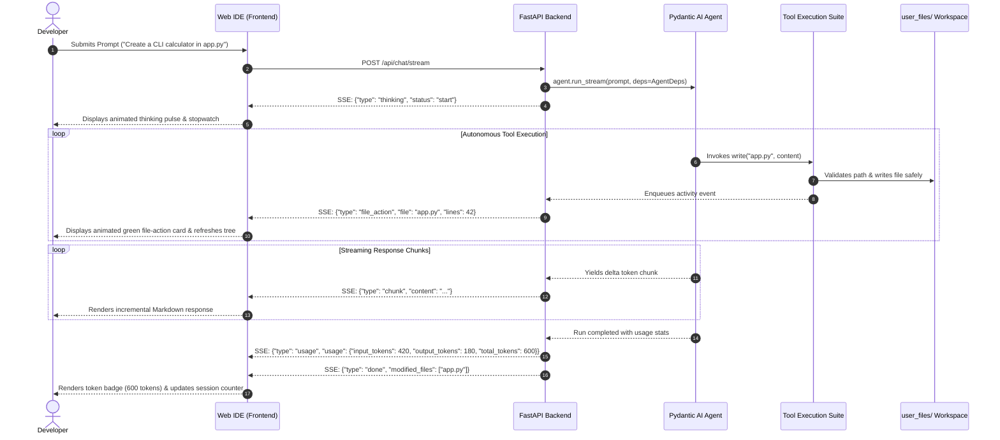

# ⚡ Code-Bud: Autonomous AI Coding Agent & Web IDE

<div align="center">

[](https://python.org)
[](https://fastapi.tiangolo.com)
[](https://ai.pydantic.dev/)
[](https://docs.astral.sh/uv/)
[](tests/)
[](LICENSE)

**Code-Bud** is an autonomous AI-powered code workspace and pair-programming IDE designed for real-time software generation. It pairs an asynchronous **FastAPI** backend and **Pydantic AI** agent harness with an ergonomic dark-mode web IDE, live tool execution telemetry, workspace isolation, and token usage accounting.

[Quickstart](#-quickstart) • [Architecture](#-system-architecture) • [Features](#-core-features) • [Testing](#-automated-testing-suite) • [API Reference](#-api-reference) • [Workshop Guide](#-workshop--presenter-resources)

</div>

---

## 🏛️ System Architecture

Code-Bud is built upon an explicit 5-layer modular architecture:

```
code-bud/
├── packages/              # [Layer 1] Shared Configuration & Models
│   ├── .env               # Local secrets & API keys (NVIDIA, Groq, OpenAI)
│   ├── .env.example       # Example environment template
│   ├── pyproject.toml     # Root workspace configuration
│   ├── uv.lock            # Deterministic dependency lockfile
│   └── shared/            # Shared Pydantic data schemas
│       └── src/shared/
│           ├── config.py  # Environment configuration parser
│           └── models.py  # ChatRequest, ChatResponse, TokenUsage, FileItem
│
├── frontend/              # [Layer 2] Web Client UI
│   ├── index.html         # Sleek single-page IDE (Explorer, Chatbox, Telemetry)
│   ├── css/style.css      # SaaS styling (dark monochrome, glassmorphism)
│   ├── src/               # TypeScript frontend source modules
│   │   ├── api.ts         # REST client & Server-Sent Events (SSE) consumer
│   │   ├── agent.ts       # AI chat controller, token counters & streaming UI
│   │   ├── explorer.ts    # Dynamic file tree with project folder switching
│   │   └── main.ts        # Frontend entrypoint
│   └── dist/main.js       # Bundled production JavaScript
│
├── backend/               # [Layer 3] FastAPI REST & SSE Services
│   ├── main.py            # FastAPI factory, static mounts & CORS middleware
│   ├── dependencies.py    # Session dependency injection & workspace binding
│   └── routes/
│       ├── chat.py        # /api/chat & /api/chat/stream (SSE delta events)
│       ├── chats.py       # /api/chats multi-session management & history persistence
│       ├── files.py       # /api/files CRUD & workspace inspection
│       └── health.py      # /api/health monitoring probes
│
├── agents/                # [Layer 4] Pydantic AI Autonomous Agent Layer
│   ├── core.py            # Agent factory, model router & tool registration
│   ├── context.py         # AgentDeps runtime state & path traversal defenses
│   ├── prompts.py         # Behavioral system instructions & tool constraints
│   └── functions/         # Granular tool execution suite
│       ├── write.py       # Full file creation & overwriting
│       ├── read.py        # File inspection with character pagination
│       ├── edit.py        # Surgical search-and-replace with difflib unified diffs
│       ├── ls.py          # Directory listing with recursion safety
│       ├── grep.py        # Regex search (ripgrep with Python fallback)
│       └── find.py        # Glob pattern file discovery
│
├── tests/                 # [Layer 5] Automated Testing Suite
│   ├── conftest.py        # Pytest fixtures & isolated workspace mocks
│   ├── test_agent_tools.py# Verification of all 6 agent tool functions & security
│   ├── test_backend_api.py# FastAPI integration tests (Health, Files, Sessions)
│   ├── test_shared_models.py # Pydantic schema validation tests
│   └── test_token_usage.py# Token extraction, sync endpoints & SSE event verification
│
├── user_files/            # Isolated User & AI Workspaces
│   ├── .chats.json        # Session registry & message history
│   └── project_1/         # Dedicated folder per project session
│
└── docs/                  # Documentation & Guides
    ├── PRESENTER_CURRICULUM_GUIDE.md # Workshop syllabus comparison & teaching guide
    ├── PARTICIPANT_SETUP_GUIDE.md    # 1-click participant setup instructions
    └── REQUIREMENTS.md               # Hardware & deployment specifications
```

---

## 🔄 Interaction Data Flow



---

## ✨ Core Features

### 1. Autonomous Agent Pairing
- Natural pair-programming: Ask the agent to scaffold services, refactor algorithms, debug errors, or add features.
- Multi-step autonomy: The agent inspects directory contents, reads relevant files, and modifies code surgically before concluding.

### 2. Live Token Telemetry & Usage Metrics
- **Per-Message Breakdown**: Every assistant response displays a sleek token chip with prompt/input and completion/output tokens:
  ```
  ⚡ 1,248 tokens (482 in · 766 out)
  ```
- **Cumulative Session Pill**: Live toolbar counter tracking the total tokens consumed across all turns in the active project.
- **SSE Streaming Events**: Real-time emission of dedicated `type: "usage"` and `type: "done"` SSE payloads.

### 3. Surgical Code Modification & Tools
- **`write`**: Writes or overwrites entire source files, creating parent directories automatically.
- **`edit`**: Surgical search-and-replace powered by `difflib.unified_diff`, returning formatted Git-style diffs and rejecting ambiguous matches.
- **`read`**: Safe file reading with character bounds (`max_chars=10_000`) and truncation warnings.
- **`ls`**: Directory listing with file sizes and type flags.
- **`grep`**: Fast pattern matching utilizing native `ripgrep` when installed, falling back cleanly to pure Python regex.
- **`find`**: Glob-based file discovery ignoring hidden caches (`.git`, `__pycache__`, `node_modules`).

### 4. Path-Traversal & Workspace Sandboxing
- All code generated or touched by the agent is confined strictly to `user_files/<project_folder>/`.
- The `resolve_path()` boundary guard verifies canonical path containment using `os.path.commonpath`, preventing directory traversal attacks (e.g., `../../etc/passwd`).

### 5. Multi-Session Project Management
- Dynamic multi-project support with live creation, selection, and deletion.
- Every chat session maps to its own directory under `user_files/` with isolated conversation history saved in `.chats.json`.

### 6. Multi-Provider LLM Routing
- Native routing configured via `.env` or frontend selector:
  - **NVIDIA NIM** (`z-ai/glm-5.3-flash`, `meta/llama-3.3-70b-instruct`, `meta/llama-3.2-11b-vision-instruct`)
  - **Groq** (`llama-3.3-70b-versatile`)
  - **OpenAI** (`gpt-4o`, `gpt-4o-mini`)

---

## 🚀 Quickstart

### Prerequisites
- **Python**: `>= 3.12`
- **uv**: Fast Python package manager ([Astral uv](https://docs.astral.sh/uv/))
- **Node.js**: (Optional, only needed if rebuilding TypeScript frontend assets)

### 1. Clone & Install

```bash
git clone https://github.com/Saisrikar20/code-bud.git
cd code-bud

# Synchronize dependencies with uv
uv sync
uv pip install -e packages/shared
```

### 2. Configure Environment

Copy the example environment template:

```bash
# Windows PowerShell
Copy-Item .env.example .env

# Linux / macOS
cp .env.example .env
```

Edit `.env` and set your preferred API key:

```ini
# Provide at least one API key:
NVIDIA_API_KEY=nvapi-your-key-here
GROQ_API_KEY=your-groq-key-here
OPENAI_API_KEY=your-openai-key-here

# Default Model Selection
AGENT_MODEL=nvidia:z-ai/glm-5.3-flash

# Server Configuration
HOST=127.0.0.1
PORT=8000
```

### 3. Launch Code-Bud

Start the application with `run.py`:

```bash
uv run python run.py
```

Open your browser at:
```
http://127.0.0.1:8000
```

---

## 🧪 Automated Testing Suite

Code-Bud includes a comprehensive 29-test automated test suite built with **pytest** and FastAPI's **TestClient**:

```bash
uv run python -m pytest -v
```

### Test Coverage Highlights

| Test File | Test Cases | What It Verifies |
|---|:---:|---|
| [`tests/test_agent_tools.py`](tests/test_agent_tools.py) | **10** | File creation, directory recursion, surgical search-and-replace, unified diff generation, grep pattern matching, and `resolve_path()` path-traversal security boundaries. |
| [`tests/test_backend_api.py`](tests/test_backend_api.py) | **6** | Health probe, model listings, file CRUD operations, file tree generation, directory breakout prevention, and multi-session chat lifecycle. |
| [`tests/test_token_usage.py`](tests/test_token_usage.py) | **8** | `TokenUsage` schema defaults, Pydantic AI usage extraction, sync endpoint token payload, and SSE streaming `usage` event emission. |
| [`tests/test_shared_models.py`](tests/test_shared_models.py) | **5** | Data serialization and typing across all core Pydantic schemas. |

---

## 📡 API Reference

### Health & System
| Endpoint | Method | Description |
|---|:---:|---|
| `/api/health` | `GET` | Health status probe and version check |
| `/api/chat/models` | `GET` | List active model and available model choices |

### Agent Chat & Streaming
| Endpoint | Method | Description |
|---|:---:|---|
| `/api/chat` | `POST` | Synchronous agent execution; returns `ChatResponse` with `usage` metrics |
| `/api/chat/stream` | `POST` | High-throughput SSE streaming endpoint yielding `thinking`, `activity`, `file_action`, `chunk`, `usage`, and `done` events |

### Sessions & History
| Endpoint | Method | Description |
|---|:---:|---|
| `/api/chats` | `GET` | List all existing chat sessions |
| `/api/chats` | `POST` | Create a new session and corresponding `user_files/` folder |
| `/api/chats/{id}` | `GET` | Get session metadata and conversation history |
| `/api/chats/{id}/history` | `POST` | Save conversation messages (including token metrics) |
| `/api/chats/{id}` | `DELETE` | Permanently remove a session and its directory |

### File Explorer & Workspace
| Endpoint | Method | Description |
|---|:---:|---|
| `/api/files/info` | `GET` | Workspace root path, active folder, git branch, and python version |
| `/api/files/tree` | `GET` | Hierarchical JSON tree of files within the active project |
| `/api/files/content?path=...` | `GET` | Read text content of a specific file |
| `/api/files/save` | `POST` | Save or overwrite file content |
| `/api/files/create` | `POST` | Create a new file or directory |
| `/api/files/delete?path=...` | `DELETE` | Delete a file or directory |

---

## 🎓 Workshop & Presenter Resources

Code-Bud is built for hands-on AI agent education:

- **[Presenter Curriculum Guide](docs/PRESENTER_CURRICULUM_GUIDE.md)**: A detailed, topic-by-topic comparison mapping the 15-topic *AGENT UNBOXED* workshop syllabus directly against Code-Bud's code, complete with demonstration guides and gap analysis.
- **[Participant Setup Guide](docs/PARTICIPANT_SETUP_GUIDE.md)**: 1-click setup guide for workshop attendees receiving a local archive.
- **[System Requirements Specification](docs/REQUIREMENTS.md)**: Detailed runtime, OS, and hardware specifications.

---

## 🛠️ Frontend Development

The frontend is written in TypeScript and modular CSS without heavyweight framework overhead.

To make changes to frontend modules in `frontend/src/`:

```bash
# Rebuild the bundle using esbuild:
npx esbuild frontend/src/main.ts --bundle --outfile=frontend/dist/main.js --sourcemap --target=es2022
```

---

## 📄 License

This project is licensed under the **MIT License**. See the [LICENSE](LICENSE) file for details.
